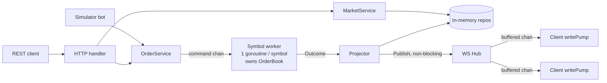

# Mini Exchange – Realtime Trading Backend (Go)

A small realtime trading backend: REST API, WebSocket streaming, an in-memory
price-time-priority matching engine and a price simulator.

## Run

```bash
go run ./cmd/server          # or: make run
make race                    # tests with the race detector
```

Environment variables (all optional):

| Var | Default | Meaning |
|---|---|---|
| `PORT` | `8080` | HTTP/WS port |
| `SIM_ENABLED` | `true` | run the price simulator |
| `SIM_INTERVAL` | `500ms` | simulator round interval (≈1,200 orders/min at default) |
| `SIM_SEED` | `42` | simulator RNG seed |
| `WS_SEND_BUFFER` | `256` | per-client outbound queue size |
| `ENGINE_QUEUE` | `1024` | per-symbol command queue size (backpressure) |
| `SHUTDOWN_GRACE` | `10s` | graceful shutdown timeout |
| `DB_PATH` | `./data/minix.db` | SQLite database file path (`:memory:` for transient testing) |
| `AUTH_ENABLED` | `true` | require JWT for order endpoints / `order.update`; `false` = legacy `X-User-ID` mode |
| `JWT_SECRET` | random per start | HS256 secret, ≥ 32 chars. **Set it in any real deployment**; otherwise tokens die on restart |
| `JWT_TTL` | `1h` | access token lifetime |
| `AUTH_USERS` | `alice:alice-pass,bob:bob-pass` | demo credential store `name:password,...` |

### Authentication (JWT)

```bash
TOKEN=$(curl -s -X POST localhost:8080/api/v1/auth/login \
  -H 'Content-Type: application/json' \
  -d '{"username":"alice","password":"alice-pass"}' | jq -r .data.access_token)
curl -s -H "Authorization: Bearer $TOKEN" localhost:8080/api/v1/orders
```

- Tokens are HS256 JWTs (`iss=minix`, `sub=<user>`, `iat`, `exp` required); other
  algorithms (including `none`) are rejected.
- With auth on, the acting user is **only** the token's `sub`; `X-User-ID` and
  `?user=` are ignored. Market data endpoints and anonymous WebSocket market
  channels remain public.

Symbols: `BBCA, BBRI, TLKM, ASII, GOTO`. Prices and quantities are integers.

Docs: [**Manual (run & test every feature)**](docs/manual.md) · [REST API](docs/api.md) · [WebSocket](docs/websocket.md) · [requests.http](api/requests.http)

## Architecture



```
cmd/server            wiring, graceful shutdown
internal/domain       entities, order book + matching (pure, no I/O)
internal/usecase      services, ports (interfaces), projector
internal/engine       per-symbol worker goroutines
internal/infra/sqlite SQLite database repositories (WAL mode, auto-migration, bcrypt users)
internal/infra/memory in-memory repositories (for testing/benchmarking)
internal/transport    http (REST via Gin: router, middleware, handlers), ws (hub, client)
internal/simulator    price/order generator
internal/e2e          end-to-end + concurrency tests
```

Dependencies point inward: `transport → usecase → domain`; `infra` and
`engine` implement interfaces declared by their consumers.

### Flow of an order

1. `POST /api/v1/orders` → validation (`domain.Order.Validate`) → `OrderService`.
2. The order is sent as a command to the worker of its symbol (non-blocking
   enqueue; full queue → `503`).
3. The worker matches it against the book (price-time priority, execution at
   the resting order's price, partial fills), producing trades and order changes.
4. The worker hands an `Outcome` to the `Projector`, which stores orders,
   trades, ticker and book snapshot, and publishes events
   (`order.update`, `market.trade`, `market.ticker`, `market.orderbook`).
5. Only then the worker replies to the HTTP caller, so the order is already
   queryable when `201` is returned.
6. The hub serializes each event once and fans it out to subscribed clients.

## Assumptions

- Only `LIMIT` orders; no lot/tick validation; no self-trade prevention.
- Authentication is JWT (see above). Credentials come from the `AUTH_USERS`
  env var in plain text: this is a demo store, not production-grade (no
  hashing, registration, refresh tokens or revocation, and no login rate
  limiting). With `AUTH_ENABLED=false` identity is the unauthenticated
  `X-User-ID` header (or `?user=` for WebSocket); missing header → `anonymous`.
- With auth, `GET /orders` is always scoped to the caller. In legacy mode it is
  scoped only when `X-User-ID` is sent.
- Storage is persisted to SQLite (`minix.db`) with WAL mode. On restart,
  active orders (`OPEN` and `PARTIAL`) are automatically rehydrated into the
  in-memory matching engine book, and rolling tickers are restored.
- Sizing: 1,000 orders/min ≈ 17 orders/s, 500 clients × ≤5 symbols ≈ 2,500
  subscriptions. A single goroutine per symbol handles this by orders of
  magnitude.

## Race conditions and consistency

- **Order book**: owned by exactly one goroutine (the symbol worker). All
  mutations arrive through a channel, so matching is sequential per symbol with
  no locks and no data races. Different symbols run in parallel.
- Concurrent submissions on one symbol are serialized in channel arrival order,
  which defines time priority (FIFO inside a price level).
- **Shared read models** (orders, trades, ticker, book snapshot) are written by
  the worker and read by HTTP handlers; they are protected by `sync.RWMutex`
  and always hold value copies (never pointers into the book).
- The worker answers the caller only after storage was updated, which gives
  read-your-writes consistency.
- Verified by `TestConcurrentSubmissionsAreConsistent` under `-race`
  (16 goroutines × 200 orders: no order overfilled, Σ fills = 2 × traded volume).

## Non-blocking broadcast

- Producers (`Hub.Publish`) use a non-blocking send into a large buffered
  queue; the matching engine never waits for WebSocket I/O.
- The hub never writes to sockets. It pushes bytes into each client's buffered
  channel with a non-blocking send; a dedicated `writePump` goroutine does the
  (deadline-bounded) network write.
- Slow consumer policy: buffer full → `market.ticker` / `market.orderbook`
  messages are dropped (the next one supersedes them); `market.trade` /
  `order.update` / acks → the client is disconnected and counted in
  `slow_clients_kicked`. Covered by `TestSlowClientDoesNotBlock`.
- Each event is JSON-encoded once, not once per client.

## Goroutine leak prevention

- Every goroutine hangs off a context derived from the root `signal.NotifyContext`
  (workers, hub, simulator, per-client contexts).
- Per connection: `readPump` runs in the handler; when it returns the client
  context is cancelled, `writePump` exits, the client is unregistered
  (idempotent) and the socket closed. Write and ping have deadlines, so dead
  peers are detected.
- Channels are never closed by receivers; clients are stopped through their
  context, which avoids "send on closed channel" panics.
- Shutdown order: stop HTTP intake → cancel context → wait for simulator/hub,
  engine workers and WS handlers (`WaitGroup`s).

## Main bottlenecks and mitigations

1. **Hot symbol on a single worker** – one symbol cannot use more than one core.
   Mitigation: it is already sharded per symbol; keep per-command work O(log n),
   batch commands, and for more scale partition symbols across instances.
2. **WebSocket fan-out** (serialization, syscalls, slow consumers) – mitigated by
   encode-once, per-client buffers with drop/kick, snapshot/coalescing for
   tickers and books; at larger scale shard hubs and run gateway nodes.
3. **Shared read models and unbounded memory** – `RWMutex`-protected maps and
   scans over slices for filtering. Mitigation: pagination/limits (already
   capped), per-symbol/user indexes, retention policy, move history to a DB and
   the hot book snapshot to Redis.

## Horizontal scaling

- Partition symbols over engine instances (consistent hashing); route order
  commands to the owner of the symbol (single writer is preserved).
- Publish events on a broker (NATS/Kafka/Redis Pub/Sub); stateless WebSocket
  gateways subscribe and fan out to their own clients.
- Replace the in-memory repositories (interfaces in `internal/usecase/ports.go`)
  with Redis/PostgreSQL; add JWT auth and rate limiting at the edge.

## Price simulation

A mean-reverting random walk per symbol drives a "market maker" bot (`user=bot`).
Every round it submits one BUY and one SELL limit order around the simulated
price (offsets of −1…+2 ticks; negative/zero offsets cross the spread). Orders
go through the normal `OrderService`, so trades, tickers and book updates are
produced by the real engine, and the realtime ticker's `last` is always the
price of the last actual trade.

## Not done (bonus / out of scope)

JWT refresh/revocation and login rate limiting, rate limiting on REST (WebSocket has a per-connection message limit),
Redis/DB persistence, message broker, metrics endpoint.

